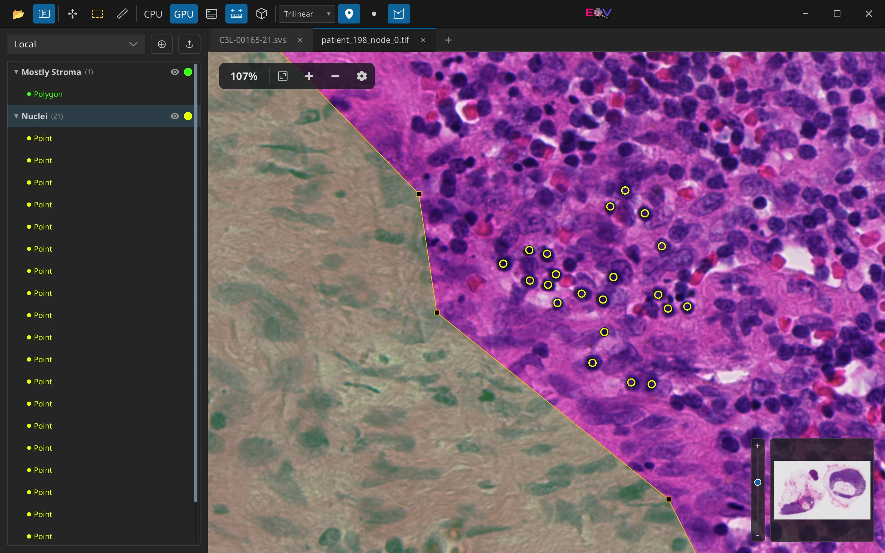

# eov — A lightweight WSI viewer

[](https://crates.io/crates/eov)
[](https://github.com/eosin-platform/eov/actions/workflows/ci.yml)
[](https://github.com/eosin-platform/eov/actions/workflows/release.yml)

[](https://github.com/eosin-platform/eov#license)
[](https://github.com/eosin-platform/eov/pulse)

<p align="center"></p>
<p align="center">
    <a href="https://eov.sh">Website</a>
</p>

eov is a cross-platform desktop viewer for whole-slide images built with [Rust](https://rust-lang.org/) and [Slint](https://slint.dev/). It fills a niche in the WSI ecosystem: a small, high-performance workbench for quickly viewing WSI files on your local machine. The feature scope is intentionally narrow with its design principle of "small Linux-style utility for WSI". However, eov is highly extensible, and a proper WSI workbench experience (e.g. annotations) can be achieved with [plugins](https://github.com/eosin-platform/eov-annotations-plugin).

Whereas the sister project [Eosin](https://github.com/eosin-platform/eosin) solves the institution-scale WSI problem, eov aims to provide researchers - and anyone else interested in WSI - with frictionless viewer capabilities free of extraneous dependencies (e.g. servers, cloud infrastructure). Outside of *explicit* actions by the user to update the app, eov **does not** "phone home", collect usage metrics, or make network requests of any kind. 

The name `eov` has no canonical expansion.

## Intended use

eov is software for research and education. It is **not a medical device**: it is not cleared or approved for primary diagnosis (for example by the FDA or under the EU IVDR), and nothing it shows should be the sole basis of a clinical decision. Colour normalisation, deconvolution, sharpening and plugin outputs (such as predicted channels or detections) are synthetic; eov labels them on screen and in exported figures.

## Installation

<!-- release-install-links:start -->
Windows, macOS, and Linux are supported. Prebuilt binaries can be downloaded from the [Release page](https://github.com/eosin-platform/eov/releases/tag/v0.4.9).

Both x86_64 and arm64 builds for all supported platforms are available. Make you sure you select the right architecture!

### Cargo
If you have the Rust toolchain installed, the application is available on all platforms through Cargo:

```
cargo install eov
```

The Cargo build links OpenSlide 4 (see [Building](#building)).

### macOS

**Note:** `eov` is not notarized by Apple. If macOS prevents it from opening, go to: System Settings → Privacy & Security → Open Anyway

#### Homebrew
Installation through Homebrew uses the [official cask](https://github.com/eosin-platform/homebrew-eov).

To install via Homebrew: 
```bash
brew tap eosin-platform/eov
brew install --cask eov
```

The `eov` cask tracks the latest stable release. Versioned casks remain pinned to an immutable release:
```bash
brew install --cask eov@0.4.9
```

`brew uninstall --zap --cask eov` also removes eov's settings, plugins and caches (`~/.eov`, `~/Library/Application Support/eov`, `~/Library/Caches/eov`).

#### Manual Installation (macOS)
The `.app` file is available. For Intel-based Macs, download the release with `x86` in the name. Apple M-series machines require the `arm64` bundle (the bundle declares the oldest macOS it runs on; macOS and Homebrew enforce it):
- [Apple Silicon (M-series)](https://github.com/eosin-platform/eov/releases/download/v0.4.9/eov-v0.4.9-macos-arm64.zip) (all Macs released since June 2023)
- [Intel (x86_64) Mac](https://github.com/eosin-platform/eov/releases/download/v0.4.9/eov-v0.4.9-macos-x86_64.zip) (All Macs released prior to 2020 and some through 2023)

### Windows
A zip file containing a portable Windows build is available:
- [x86_64](https://github.com/eosin-platform/eov/releases/download/v0.4.9/eov-v0.4.9-windows-x86_64.zip) (most Windows machines)
- [arm64](https://github.com/eosin-platform/eov/releases/download/v0.4.9/eov-v0.4.9-windows-arm64.zip) (rarer)

Extract the zip; it contains a single `eov` folder. Keep that folder dedicated to eov (the self-updater replaces it as a whole and refuses to run if it contains unrelated files), then run `eov.exe` inside it. Only the portable version is available; no Windows installer is planned. Unless the release is code-signed, you'll get a security alert when attempting to open it. This alert can be safely bypassed through the "Run anyway" button. You will be hassled by this dialog every time you download a new version.

If you want the `eov` command to be available via PATH (e.g. for command prompt or PowerShell) you can do this by [adding `C:/path/to/eov` to System Variables](https://learn.microsoft.com/en-us/previous-versions/office/developer/sharepoint-2010/ee537574%28v%3Doffice.14%29) (given `C:/path/to/eov/eov.exe` reflects your directory structure). In a terminal, `eov` then runs `eov.com`, a small console launcher shipped next to `eov.exe`: command output, `--help` and the prompts of `eov update` appear in the terminal, and the terminal waits for the command to finish. Errors that stop the viewer from starting are shown in a dialog.

To have Explorer offer eov for slide files ("Open with", double-click) and open `eov://` links, run `eov register-file-types` once (for your account only; run it again after moving the folder, and `eov unregister-file-types` to undo). See [File associations](#file-associations).

### Linux
There are two methods of installation.

- AppImage: [x86_64](https://github.com/eosin-platform/eov/releases/download/v0.4.9/eov-v0.4.9-linux-x86_64.AppImage) | [arm64](https://github.com/eosin-platform/eov/releases/download/v0.4.9/eov-v0.4.9-linux-arm64.AppImage)
- Flatpak: [x86_64](https://github.com/eosin-platform/eov/releases/download/v0.4.9/eov-v0.4.9-linux-x86_64.flatpak) | [arm64](https://github.com/eosin-platform/eov/releases/download/v0.4.9/eov-v0.4.9-linux-arm64.flatpak)

The AppImage runs on any distribution with glibc 2.28 or newer (RHEL/Rocky/AlmaLinux 8 and later, Debian 10 and later, Ubuntu 18.10 and later). The Flatpak is installed with `flatpak install --user <file>.flatpak` (or `--system`); it can read slides in your home directory and, read-only, on drives under `/media`, `/run/media` and `/mnt`. See [packaging/flatpak](packaging/flatpak/README.md) to grant access to other locations or, on Flatpak older than 1.15.6, to game controllers.

The AppImage is directly executable:

```bash
# Download the binary
curl -L -o eov https://github.com/eosin-platform/eov/releases/download/v0.4.9/eov-v0.4.9-linux-x86_64.AppImage

# Make it executable
chmod +x ./eov

# Run it directly
./eov

# Install it system-wide (optional)
sudo mv eov /usr/local/bin/eov

# Start the installed app with a nice, short command from any directory:
eov

# Optional: let file managers open slides and eov:// links with this AppImage
eov register-file-types
```
<!-- release-install-links:end -->

### Example WSI Files

To make testing easier, here are a few (relatively) small WSI files that can be opened by `eov`. These are clear cell renal carcinoma slides from The Cancer Imaging Archive's [CPTAC-CCRCC](https://www.cancerimagingarchive.net/collection/cptac-ccrcc/) available under [CC BY 4.0](https://creativecommons.org/licenses/by/4.0/):
- [C3L-00004-21.svs](https://cptac.nyc3.digitaloceanspaces.com/images/CPTAC-CCRCC/C3L-00004-21.svs) (169MB)
- [C3L-00088-22.svs](https://cptac.nyc3.digitaloceanspaces.com/images/CPTAC-CCRCC/C3L-00088-22.svs) (322MB)

Refer to the [data appropriation guide](./data-guide.md) for details on how to bulk download WSI files from various datasets.

## Overview

eov opens pyramid-based whole-slide image files through OpenSlide, and OME-TIFF (brightfield, fluorescence and multiplexed immunofluorescence) through its own reader, and presents them in a desktop viewer designed for fast inspection.

Current capabilities include:

- Open WSI files from the file picker, drag and drop, the recent-files list, the command line, the file manager ("Open With", double-click) or `eov://` links that point at a place on a slide (see [Opening slides](#opening-slides)). Drag and drop needs X11, Windows or macOS: the windowing library eov uses (winit 0.30) does not receive drops on Wayland, so on a Wayland desktop start eov with `env -u WAYLAND_DISPLAY eov` (it then runs through XWayland) or open slides another way.
- One eov window: opening more slides while eov runs adds them as tabs instead of starting another eov.
- A tab- and pane-based layout
- Duplicate tabs into additional panes for side-by-side comparison.
- Link panes that show different slides (H&E next to IHC, serial sections): they pan, zoom and turn together, at equal µm per screen pixel when both slides record a pixel size. Align them by moving one pane alone (adjust mode, next to the link button) or from two landmarks placed on each slide (viewport menu); alignments are kept per slide pair.
- Drag tabs between panes, reorder tabs, and create splits by dropping onto pane edges.
- Show a slide in the file manager: **Open Containing Folder** opens its folder with the slide selected.
- Pan and zoom smoothly with on-demand tile loading and cached rendering.
- Toggle between CPU and GPU rendering (Vulkan, DirectX 12 or Metal). Without a usable GPU (virtual desktops, remote sessions, VMs) eov draws its window with a software renderer and slides on the CPU, and says why; `EOV_RENDERER=software` forces this.
- Adaptive [Lanczos](https://en.wikipedia.org/wiki/Lanczos_resampling) (high quality), [Trilinear](https://en.wikipedia.org/wiki/Trilinear_filtering) (industry standard, performant), and [Bilinear](https://en.wikipedia.org/wiki/Bilinear_interpolation) (fast) texture filtering.
- Real-time image adjustments: sharpness (unsharp mask), gamma, brightness, and contrast sliders applied via convolution + per-channel LUT (CPU) or per-pixel shader (GPU).
- Stain normalization: Macenko (SVD/PCA angular-percentile) and Vahadane (sparse non-negative dictionary learning) methods, both running on CPU and GPU backends with matched output.
- Color deconvolution: separate and visualize individual H&E stain channels with per-channel intensity control and channel isolation, on both CPU and GPU.
- Multichannel fluorescence and multiplex OME-TIFF: the channels are composited with a colour, display window and gamma each, set in the Channels panel and kept per slide, and Z-stacks are stepped through plane by plane (see [OME-TIFF, fluorescence and multiplex](#ome-tiff-fluorescence-and-multiplex)).
- A calibrated scale bar with automatic unit selection (µm, mm, inches) when microns-per-pixel metadata is available, and a pixel size you can set for slides that lack one (Slide Information, kept per slide).
- A minimap thumbnail with viewport navigation and a zoom slider.
- Slide Information (I): the label and macro images (with a privacy toggle to hide the label), and every property, searchable and copyable.
- Objective-equivalent magnification presets (1–6, 0 for 1:1), fit to the slide or to its tissue, rotation in quarter turns and mirroring, full screen, and a remappable keyboard shortcut table (F1 lists it).
- Back and forward through the views of a pane (Alt+←/→), named bookmarks of views (Ctrl+B), and the open slides and views restored at the next start.
- A region of interest and a measurement suite: distance, path length, polygon, rectangle and ellipse area, and angle, in the slide's physical units, listed in a Measurements panel (copy, go to, CSV) and kept per slide.
- Stain quantification in the region of interest for IHC (positive fraction, intensity bins, H-score; see [Stain Quantification](#stain-quantification)).
- Heat maps from other tools over a slide (a model's probabilities, an attention map), from PNG, JPEG or TIFF, coloured, placed and kept per slide (see [Heat Maps](#heat-maps)).
- Tissue QC: pen marks, possible folds and out-of-focus areas marked over the slide, summarised per slide and cohort (`eov qc`), and left out of datasets on request (see [Tissue QC](#tissue-qc)).
- A series bar for the slides of a folder: filter, order by name, date, stain or case (the case is read from the file name: `C3L-00011-21.svs` belongs to `C3L-00011` and `patient_198_node_0.tif` to `patient_198`, a TCGA barcode to its participant, or what `series_case_pattern` in `config.toml` captures), one entry per DICOM series (DICOM annotations and reports in the folder are not listed), and PageUp/PageDown to step through them.
- Copy the view and Export Image (right-click the viewport): PNG, JPEG or TIFF with configurable DPI, filtering, the colour processing shown, plugin and measurement overlays, a scale bar and a note, rendered in bands so any size works; files say what processing was applied.
- Dataset patch extraction: fixed-grid patches from one or more slides at a chosen resolution, with tissue filtering and tissue-QC exclusion, annotation labels and masks, stain normalisation, resumable runs, CSV/JSON metadata, optional de-identification and packing into a zarr store (from the toolbar or the CLI).
- Save a copy of a slide, or of its region of interest, as a pyramidal TIFF or OME-TIFF that other tools read, optionally de-identified (no label or macro image, no identifying metadata), from the tab menu or with `eov convert` (see [Converting and De-identifying Slides](#converting-and-de-identifying-slides)).
- Plugins (see [Plugins](#plugins)), managed from the Plugins panel or `eov plugin`, and verified application and plugin updates (`eov update`, or Check for Updates on the Home screen).
- Scripting: drive the running viewer and read slide regions from Python or the shell, over a local, authenticated endpoint (see [Scripting](#scripting)).
- An audit log of what eov ran with (`<data>/audit.jsonl`: versions and plugins, installs and updates), and a session log and crash reports in the log folder.

## Keyboard Shortcuts

Press **F1** (or **?**) for the list of shortcuts, including the keys of
installed plugins. On macOS, **Ctrl** below means **⌘**.

| Keys | Action |
|---|---|
| Ctrl+O, Ctrl+W | Open a slide, close the tab |
| Ctrl+Tab, Ctrl+Shift+Tab | Next or previous tab in the pane |
| PageDown, PageUp | Next or previous slide of the folder |
| I | Slide information (label, macro image, properties, pixel size) |
| Ctrl+C, Ctrl+E | Copy the view as an image, export the view |
| F, Shift+F, +, - | Fit the slide, fit its tissue (without the empty glass), zoom in, zoom out |
| Arrows (Shift: further) | Pan |
| Ctrl+↑, Ctrl+↓ | Next or previous focal plane of a Z-stack |
| Ctrl+→, Ctrl+← | Next or previous time point of a time series |
| 1 2 3 4 5 6, 0 | Zoom to 1.25×, 2.5×, 5×, 10×, 20×, 40×; one screen pixel per slide pixel |
| [, ], Shift+H | Rotate the view 90° left or right, mirror it |
| Ctrl+L | Link the panes' slides, so they move together (different slides too) |
| Alt+←, Alt+→ | Back and forward through the pane's views |
| Ctrl+B, Ctrl+Shift+B | Bookmark the view, list the slide's bookmarks |
| N, R, D | Navigate, region of interest and measure tools |
| Ctrl+Z, Ctrl+Shift+Z or Ctrl+Y | Undo, redo |
| M, F11 | Minimap, full screen |
| Ctrl+Shift+W | Quit |

Change keys in the `[shortcuts]` table of `config.toml`, by the action
names the panel shows in grey:

```toml
[shortcuts]
bookmark-add = "Ctrl+D"      # a key
zoom-in = ["+", "=", "W"]    # several keys
slide-info = []              # no key
```

A key given to one action is taken from any other. Escape, Enter, Delete,
Backspace and Tab keep their meaning in the viewport and dialogs.
Plugins cannot bind a key eov uses. Changes apply when eov starts, and
entries eov cannot use are reported in the Messages popup.

## Screenshots

<p align="center">
    
    &nbsp;
    
    &nbsp;
    
</p>

With the [annotations plugin](https://github.com/eosin-platform/eov-annotations-plugin):
<p align="center">
    
</p>

## Texture Filtering

eov provides three texture filtering modes, selectable in the window toolbar (or `filtering_mode` in `config.toml`, `--filtering-mode` on the command line):

| Mode | Description |
|------|-------------|
| **Bilinear** | Single mip-level sampling. Fastest, but can exhibit aliasing at low zoom. |
| **Trilinear** | Bilinear sampling with mip-level blending for smooth transitions across zoom levels. The default mode. |
| **Lanczos-3** | High-quality resampling using a windowed sinc kernel (a=3). Adaptively blends with trilinear at very low zoom to avoid ringing artifacts. |

Both CPU and GPU backends support all three modes. On the GPU path, trilinear blending is performed by sampling fine and coarse mip textures and mixing in the fragment shader. Lanczos resampling is implemented as a separable kernel evaluated per-pixel in a dedicated shader.

**Show Pixels Above 100%** (in the same menu, `show_pixels` in `config.toml`) draws the slide's pixels as sharp squares wherever a pane magnifies it beyond its full resolution (more than one screen pixel per slide pixel), instead of smoothing them; below that the filtering mode applies. Both renderers sample the same pixels, and exports that magnify a view do the same while the setting is on.

## Image Adjustments

Real-time image adjustment controls are available in the HUD settings panel:

| Parameter | Range | Default | Description |
|-----------|-------|---------|-------------|
| Sharpness | 0.0 – 1.0 | 0.0 | Unsharp mask via 4-connected Laplacian kernel. 0 = disabled (bypass), 1 = maximum sharpening. |
| Gamma | 0.2 – 3.0 | 1.0 | Power-law intensity curve. Values below 1.0 brighten shadows; above 1.0 darkens them. |
| Brightness | -1.0 – 1.0 | 0.0 | Additive offset applied after gamma correction. |
| Contrast | 0.2 – 3.0 | 1.0 | Multiplicative scaling around the midpoint (0.5) after brightness. |

The CPU backend applies sharpening as a Laplacian convolution pass over the composited buffer, followed by gamma/brightness/contrast through a precomputed 256-entry lookup table. The GPU backend applies the same pipeline per-pixel in the fragment shader.

## Stain Normalization

eov includes two H&E stain normalization methods for histology images, selectable from the HUD settings panel:

- **Macenko** ([Macenko et al., 2009](https://www.researchgate.net/publication/221624097_A_Method_for_Normalizing_Histology_Slides_for_Quantitative_Analysis)): Projects tissue optical density onto its principal stain plane via SVD, then identifies hematoxylin and eosin vectors from angular percentile extremes (1st and 99th percentile).
- **Vahadane** ([Vahadane et al., 2016](https://pubmed.ncbi.nlm.nih.gov/27164577/)): Learns a two-component stain dictionary via sparse non-negative matrix factorization with L1 (LASSO) regularization, producing a physically-motivated decomposition that preserves local tissue structure.

Both methods share a common normalization pipeline: RGB → optical density conversion, tissue masking, stain matrix estimation, least-squares concentration solve, 99th-percentile concentration scaling to a reference target, and reconstruction. The CPU and GPU backends produce matched output — stain matrix estimation runs on the CPU from raw tile data, while per-pixel normalization runs either as a CPU buffer pass or as a GPU fragment shader transform.

**The target.** By default slides are normalised onto Macenko's reference H&E. With normalisation on, the viewport menu can make **this slide** or its **region of interest** the target instead ("normalise to reference slide"): every pane that normalises, and every export, then maps its slide onto that appearance. **Save Stain Target…** writes the target (its stain vectors, concentrations and where it came from) to a JSON file to share between sites, **Load Stain Target…** reads one, and **Use the Reference Stain Target** goes back to the default. The target in use is kept in `<data>/stain-target.json`. Dataset extraction uses a saved target with `eov dataset patches … --normalize macenko --stain-target reference.json`. A fit that was rejected (too little tissue, collinear stains) cannot be a target.

## Color Deconvolution

eov supports real-time H&E color deconvolution, which separates a histology image into its constituent hematoxylin and eosin stain channels using the Beer–Lambert optical density model ([Ruifrok & Johnston, 2001](https://pubmed.ncbi.nlm.nih.gov/11531144/)). Controls are available in the HUD settings panel:

- **Intensity control**: adjust per-channel stain intensity to enhance or suppress individual components.
- **Channel isolation**: view a single stain channel in isolation to inspect hematoxylin (nuclei) or eosin (cytoplasm/stroma) contributions separately.
- **Channel visibility**: click a channel's letter (H, E) to hide or show it.

When stain normalization is active, the deconvolution reuses the slide-specific stain matrix estimated by the normalization step, so channel separation reflects the actual stain vectors of the current slide. Otherwise the default Ruifrok & Johnston reference matrix is used. Both CPU and GPU backends are supported.

## Colour Management

Many scanners record an ICC colour profile with the slide (Aperio's "ScanScope v1", Roche's DP 200 profiles, …). eov converts such a slide's colours from its profile to sRGB, on both renderers, in the viewport, the minimap, copies and exports. The HUD shows **ICC** while a slide is colour-managed; click it (or **Show Colours as Scanned** in the viewport menu) to see the colours as scanned, and again to convert them. Slides without a profile have no indicator.

The conversion is the last colour step before the background: stain normalisation, deconvolution, tone adjustments and plugin filters work on the slide's own colours, and so do region reads by plugins, stain quantification and dataset extraction. eov samples each profile's conversion into a 33×33×33 table that both renderers interpolate the same way (within 2 levels of the exact conversion on stained tissue). It assumes an sRGB display, and supports RGB profiles of the matrix/TRC and LUT kinds; other profiles are reported on the HUD and the slide is shown as scanned.

## Stain Quantification

For brightfield IHC and special stains, **Quantify Stain in Region…** (right-click a slide with a region of interest) measures one stain in the region of interest: the share of tissue pixels positive for it, the weak (1+), moderate (2+) and strong (3+) shares, an H-score (0–300) and the mean concentration. It uses the same colour-deconvolution model as the view, with the H-DAB, H&E, H-E-DAB, H-AEC, H-PAS or Masson trichrome stain vectors (Ruifrok & Johnston), suggested from the slide's stain label; the thresholds are stain concentrations and can be changed. Glass and ink are left out, the region is read at the finest resolution that keeps it under 16 megapixels, and the results can be copied with the model and thresholds used. As everything in eov, this is for research and education, not diagnosis.

## Heat Maps

**Show Heat Map…** (right-click a slide) draws an image made by another tool over the slide, under the annotations: a model's per-patch probabilities, an attention or uncertainty map, a segmentation. PNG, JPEG and TIFF (8- and 16-bit, floating point; the first image of a TIFF) of up to 64 megapixels are read. A single-channel image, or a colour image whose pixels are all grey, holds values: 8-bit pixels become 0–1 by dividing by 255, 16-bit ones by 65 535, and floating-point ones are used as they are when they all lie in 0–1, or scaled from their minimum to their maximum otherwise. Values are drawn through Viridis, Inferno, Jet or grey; zero (and transparent or NaN pixels) is background and not drawn, and **Hide values below** leaves out low values too. Colour images keep their colours.

The panel places the map where the file says (a PNG may record `eov:level0_px_per_pixel` = `"sx,sy"` and `eov:origin` = `"x,y"` in level-0 pixels in `tEXt` chunks; eovae's maps do), over the whole slide (the default otherwise, for maps made at a fixed downsample of the slide), over its scanned region, from the top-left corner at a given downsample (level-0 pixels per map pixel), or at a given pixel size in µm. Opacity, smoothing and visibility change at once. What was shown is remembered per slide in `<data>/heatmaps.toml` and shown again when the slide opens; **Remove** forgets it. Heat maps appear in viewport copies and exported images.

## Tissue QC

**Check Tissue Quality** (right-click a brightfield slide) looks for pen marks, possible tissue folds and out-of-focus areas, cell by cell (128 µm cells, or 512 px without a pixel size), and colours the marked cells over the slide: blue for pen, orange for possible folds, yellow for possibly out of focus. It runs as a status-bar job and reports what share of the tissue each covers; **Copy Tissue QC Summary** copies that line and **Hide Tissue QC** removes the overlay. `eov qc` does the same for many slides from the command line, as text or JSON.

How it decides: a low-resolution pass classifies each pixel as glass, tissue (by saturation, with Otsu's threshold) or ink (green, blue to cyan, or black, colours H&E and IHC stains do not produce; skipped for trichrome and other green or blue stains). A cell with at least 15 % ink is a pen mark. A tissue cell whose darkness (the optical density of its brightest channel, so bright red blood does not count) is at least 2.5 times the slide's median is a possible fold. A second pass reads the cells that are mostly tissue at about 2 µm/px and compares their fine detail (the variance of the Laplacian relative to the variance of the image) with the slide's median: below 35 % is possibly out of focus. Tissue without fine detail, such as fibrin, mucus or necrosis, can be marked as well. The thresholds are relative to each slide, and the marks are for review, not measurements.

## Supported Formats

eov opens slides through [OpenSlide](https://openslide.org/), so it opens the formats OpenSlide supports on the host system, and it reads OME-TIFF itself (see below). The application explicitly offers these common extensions in the file picker:

- `.svs`
- `.tif`
- `.dcm`
- `.ndpi`
- `.vms`
- `.vmu`
- `.scn`
- `.mrxs`
- `.tiff`
- `.svslide`
- `.bif`
- `.czi`
- `.btf`, `.tf2`, `.tf8` (BigTIFF, as in `.ome.btf`)

If OpenSlide can open the file, eov should be able to load it. File managers offer eov for these formats once it is registered with the operating system (see [File associations](#file-associations)).

### OME-TIFF, fluorescence and multiplex

OpenSlide reads brightfield RGB slides only, so eov has its own reader for OME-TIFF: files named `.ome.tif`, `.ome.tiff` or `.ome.btf`, and any TIFF or BigTIFF whose first image description is OME-XML. Other TIFFs still open through OpenSlide. The reader handles:

- brightfield RGB, and multichannel fluorescence and multiplexed immunofluorescence (CyCIF, Orion and other OME-TIFF exports) with any number of channels of 8-, 16- or 32-bit integer or 32- or 64-bit float samples, one plane per channel or several channels in one plane;
- TIFF and BigTIFF in either byte order, tiled or in strips, uncompressed or compressed with LZW, Deflate, PackBits, Zstandard or JPEG;
- pyramids stored as SubIFDs (the current OME convention), as separate images of decreasing size, or as reduced-resolution images in the main chain;
- the pixel size (`PhysicalSizeX`/`PhysicalSizeY`, in any length unit) and the objective's nominal magnification; label, macro and thumbnail images; the OME metadata, as `ome.*` properties in Slide Information.

A file eov cannot read, for example one with another compression or with channels stored in other files of a multi-file OME dataset, is refused when it opens, with the reason. A Z-stack shows its first focal plane; Ctrl+↑ and Ctrl+↓ step through the planes, and a time series shows its first time point, with Ctrl+→ and Ctrl+← to step through time (Slide Information and the Channels panel show how many there are and which is shown); the minimap and copies follow. A plane that cannot be read ends the stack there, and a time point with such a plane ends the series before it.

Multichannel slides are shown as a composite: each visible channel adds its colour, scaled by where its value lies in the channel's display window and by a gamma. A slide opens with the colours its file gives the channels (else colours from the channel names, DAPI and Hoechst in blue, and emission wavelengths), auto-contrast windows (the 0.1 and 99.9 percentiles of a low-resolution level) and its first six channels shown. **Channels…** (right-click the slide, or the button in Slide Information; the `channels` shortcut action has no key by default) opens the Channels panel:

- show, hide or solo each channel and pick its colour, or colour all of them from a palette: Standard, Colour-blind safe or Okabe–Ito;
- set a channel's window by dragging its ends over the channel's histogram or by typing values, and set its gamma;
- Auto contrast, Show all, and Reset to the slide's defaults.

The settings are kept per slide, keyed by its identity, and come back when it opens again. The view, the minimap, copies and exports, and plugins all see the composite; plugins also get the channel names. `eov probe` lists the channels with their colours and windows. Dataset extraction uses the display of a slide that is open in eov and the defaults for other slides; batch runs use the defaults.

## CLI

The application can be launched as a desktop viewer or used through a small CLI surface:

```text
eov [OPTIONS] [FILES]... [--pane FILES]... [--goto X,Y] [--zoom ZOOM]
eov probe [--json] <FILE>
eov qc [--json] [--no-sharpness] [--cell-um <UM>] <SLIDES>...
eov recent list
eov config-path
eov paths [--json]
eov register-file-types [--dry-run]
eov unregister-file-types [--dry-run]
eov update [--release <VERSION>] [--app-only] [--from <DIR>] [--rollback] [--dry-run] [--json] [--allow-network] [-y]
eov plugin ls|list [--json] [--allow-network]
eov plugin install|add <SOURCE> [--force] [--dry-run] [--json] [--allow-network] [-y]
eov plugin update|upgrade <SOURCE> [--force] [--dry-run] [--json] [--allow-network] [-y]
eov plugin remove|rm|uninstall <PLUGIN|FILE> [--dry-run] [--json] [-y]
eov plugin info|inspect <PLUGIN> [--output plain|toml|json]
eov plugin disable|enable <PLUGIN>
eov plugin lock [-o <FILE>]
eov plugin sync <LOCKFILE> [--from <DIR>] [--prune] [--dry-run] [--allow-network] [-y]
eov plugin gc
eov dataset patches <INPUTS>... --out <DIR> --tile-size <PX> --stride <PX>
eov convert <INPUT> <OUTPUT> [--region <X,Y,W,H>] [--level <N> | --mpp <UM>] [--compression jpeg|deflate] [--quality <Q>] [--tile-size 256|512] [--format tiff|ome-tiff] [--deidentify] [--overwrite]
eov call <METHOD> [PARAMS] [--out <FILE>]
eov script-endpoint [--json]
```

Examples:

```bash
eov slide.svs
eov slide1.svs slide2.svs slide3.svs              # one pane, three tabs
eov he.svs --pane ki67.svs                        # two panes side by side
eov slide.svs --goto 1200,800 --zoom 20x          # open at a place, at 20x
eov 'eov://open?path=%2Fslides%2Fslide.svs&x=300um&y=200um&zoom=20x'
eov --debug --backend gpu slide.svs
eov --cache-size 512 --max-tiles 4096 slide.svs
eov --cpu slide.svs
eov --gpu --filtering-mode lanczos slide.svs
eov --log-level debug probe fixtures/C3L-00088-22.svs
eov probe --json slide.svs > slide.json
eov qc --json cohort/ > qc.json                   # pen marks, folds and blur per slide
eov --config /tmp/config.toml config-path
eov paths
eov recent list
```

`eov --help` explains every option. Notable ones:

- `--pane <FILES>` to open more panes side by side (repeatable; see [Opening slides](#opening-slides))
- `--goto <X,Y>` and `--zoom <ZOOM>` to open the first slide at a place and magnification
- `--new-instance` to start a separate eov even when one is running
- `--backend auto|cpu|gpu`
- `--cpu` and `--gpu` as shorthands for `--backend cpu|gpu`
- `--debug` to enable debug overlays in the UI
- `--log-level error|warn|info|debug|trace`
- `--cache-size <MB>` to fix the tile-cache budget in megabytes (at most 1048576). By default the budget follows the window: about two full frames per visible pane, between 256 MB and 4 GB.
- `--max-tiles <COUNT>` to fix the maximum number of cached tiles (1 to 16777216; default: sized with the budget).
- `--config <PATH>` to override the active config file path for the current process (a leading `~` is expanded, also in `--config=~/...`)
- `--plugin-dir <PATH>` to set the plugin search directory. Default: `~/.eov/plugins/`
- `--window-width`, `--window-height` and `--window-x`/`--window-y` (given together) for the window's size and position in logical pixels. Wayland ignores positions, because the compositor places windows; eov says so.
- `--safe-mode` (or `EOV_SAFE_MODE=1`) to start without loading any plugin, for example after a plugin crashed eov at startup

`eov probe` prints everything about a slide: size, pyramid levels, pixel size, objective, stain, scanned bounds and regions, ICC profile size, associated images (label, macro, thumbnail), quickhash, the channels of multichannel slides and every property; `--json` prints the same for scripts. `eov paths` lists every place eov keeps data (see [Configuration And Persistence](#configuration-and-persistence)). `eov call` calls the running eov's scripting interface (see [Scripting](#scripting)).

### Opening slides

**Tabs and panes.** Every file on the command line opens as a tab of the current pane, in the order given; the first one is selected and the others open behind it. `--pane FILES` opens another pane side by side, and can be repeated. An argument that exists on disk is always taken as it is, so names with commas (`"Case 12, H&E.svs"`) work; an argument that does not exist but contains commas is a list of files, as in eov < 1.0 (`eov a.svs,b.svs`, `--pane c.svs,d.svs`). A folder opens in the series bar with its first slide. `file://` URIs, which file managers pass, are decoded, and paths that are not valid UTF-8 work. Files that cannot be opened (missing, unreadable, not a slide) are reported in the window, and everything else still opens.

**Deep links.** `--goto X,Y` centres the first slide on a point given in level-0 pixels (`--goto 1200,800`, OpenSlide's coordinates) or in micrometres from the slide's top-left corner (`--goto 300um,200um`, which needs the slide's pixel size). `--zoom` takes an objective-equivalent magnification (`20x`; from the slide's objective, or about 10 µm ÷ pixel size), screen pixels per slide pixel (`0.5`; `1` or `1:1` is full resolution) or `fit`. If the slide is already open, its view moves there. When a slide lacks what a position or magnification needs, eov says so in the window and opens it as usual.

An `eov://` link carries the same information, for laboratory systems, spreadsheets of findings or teaching material:

```text
eov://open?path=<percent-encoded absolute path>&x=<X>&y=<Y>&zoom=<ZOOM>
eov://open?path=%2Fslides%2FS12-3456%20A1.svs&x=300um&y=200um&zoom=20x
eov://open?path=C%3A%5Cslides%5CS12-3456%20A1.svs&x=14000&y=9000&zoom=10x
```

Percent-encode the path (in a spreadsheet, `=HYPERLINK("eov://open?path=" & ENCODEURL(A2) & "&x=" & B2 & "&y=" & C2 & "&zoom=20x", "Open")`); `+` means a space. `x` and `y` take the values of `--goto`, `zoom` those of `--zoom`, and both are optional; unknown parameters are ignored. Clicking a link starts eov, or hands the link to the eov that runs. On Windows, a link to a network path (`\\server\share\...`) is only followed if the server is listed in `trusted_link_servers` in `config.toml`: merely looking at such a path makes Windows sign in to that server with your credentials, which a link on a web page could abuse. Mapped drive letters need no setting.

**Single instance.** While eov runs, `eov FILES` (from a terminal, a file manager or a link) hands the files to it: they open as tabs, the window comes to the front (on Wayland, which lets no program raise itself, it asks for attention instead) and the second eov exits. `eov` without files just brings the running one forward. Options that configure the viewer itself (`--cpu`, `--gpu`, `--backend`, `--filtering-mode`, `--debug`, `--log-level`, `--cache-size`, `--max-tiles`, `--window-*`, `--viewport-lock`, `--safe-mode`) start a separate eov, as do `--new-instance` and `single_instance = false` in `config.toml`; subcommands never hand anything over. Such an eov still takes the endpoint described below when no other eov holds it: it serves [scripts](#scripting), and files handed over by later launches open in it. eovs with a different home, configuration file or plugin folder (`EOV_HOME`, `--config`, `--plugin-dir`) run separately.

The running eov listens on a Unix-domain socket (Linux, macOS) or a localhost port (Windows, or where the socket's path would be too long) in a folder only you can use: `$XDG_RUNTIME_DIR/eov` on Linux (`$XDG_RUNTIME_DIR/app/io.eosin.eov` in the Flatpak), `$TMPDIR/eov` on macOS, `%LOCALAPPDATA%\eov\run` on Windows, or `$EOV_RUNTIME_DIR`. Both sides prove that they know a secret stored there before any path is exchanged, so other users and programs that merely squat on the port learn nothing. If eov crashed, the next start takes over its leftovers; if the running eov does not answer within 20 seconds, the new one starts on its own.

### File associations

| Platform | How eov is offered for slides and `eov://` links |
|---|---|
| Flatpak | Automatic: the Flatpak exports its MIME types (`io.eosin.eov.xml`) and desktop entry. |
| AppImage, `cargo install` | Run `eov register-file-types` once: it writes the MIME package, a desktop entry that starts this eov and its icon to `~/.local/share` and updates the desktop's caches. AppImage integration tools that install the AppImage's desktop entry (with `usr/share/mime/packages/io.eosin.eov.xml`) work too. |
| macOS | Automatic: the app declares the formats and the `eov` URL scheme in its `Info.plist`, and macOS registers them when it first sees the app (for example after moving it to Applications). |
| Windows (portable zip) | Run `eov register-file-types` once. It writes only `HKEY_CURRENT_USER\Software\Classes`: an `eov.Slide` file type, an "Open with" entry for every slide extension, `Applications\eov.exe` and the `eov` URL protocol. eov becomes the default program only for the vendor formats (`.svs`, `.ndpi`, `.mrxs`, ...) that have none; TIFF and DICOM keep theirs. Run it again after moving the eov folder; `eov unregister-file-types` removes exactly these entries. |

`--dry-run` shows what either command would change. The slide types are TIFF (`image/tiff`), DICOM (`application/dicom`) and eov's own MIME types for the vendor formats (`image/x-aperio-svs`, `image/x-hamamatsu-ndpi`, `image/x-hamamatsu-vms`, `image/x-hamamatsu-vmu`, `image/x-leica-scn`, `image/x-mirax`, `image/x-sakura-svslide`, `image/x-ventana-bif`, `image/x-zeiss-czi`) and for BigTIFF (`image/x-bigtiff`: `.btf`, `.tf2`, `.tf8`, for which eov is only offered, as for TIFF and DICOM); a Leica `.scn` is told apart from a Godot scene by its TIFF header.

On macOS, slides opened from the Finder or the Dock and `eov://` links arrive as Apple events rather than on the command line. winit 0.30, the windowing library under Slint, does not pass these on, so eov adds the `application:openURLs:` handler to winit's application delegate at startup (winit patches AppKit the same way) and opens what arrives like files handed over by a second eov. Two consequences: a slide double-clicked while eov is not running opens as a tab next to the restored last session, because macOS starts the app without arguments first; and if a future winit implements the handler itself, eov keeps winit's and logs a warning (files from the Finder would then be ignored until eov is updated).

### Application and plugin updates

Updates are explicit actions: `eov update` on the command line, or **Check for Updates…** at the bottom of the Home screen. eov does not check GitHub at startup, run background update checks, or collect telemetry.

**From the window.** Check for Updates asks before it contacts GitHub, then shows the same plan as `eov update` (the installed and available versions, the signature status, how this installation is updated, the release notes link and the plugin changes) and changes nothing until you choose Update. AppImage, Homebrew and Cargo updates are used from the next start; a Windows portable folder or a manually installed macOS bundle closes eov, lets the update helper replace the application and starts eov again with the session restored. Installations eov does not manage (a distribution package, a policy that turns self-update off) are told where the new release is. The administrator policy applies as on the command line.

```bash
eov update                       # newest release, with the official plugins it pins
eov update --dry-run             # show the plan only (add --json for scripts)
eov update --release 1.0.1       # exactly this release; downgrades are allowed
eov update --app-only
eov update --rollback            # restore what the last update replaced (run again to undo)
eov update --from /media/usb/eov-1.0.1   # offline bundle, see below

eov plugin ls                    # installed plugins; with network access, compared with the catalog
eov plugin install gamepad
eov plugin install gamepad@1.0.1
eov plugin install github.com/foo/bar
eov plugin install github.com/foo/bar@some-tag
eov plugin install ./example.eop
eov plugin update gamepad
eov plugin disable gamepad       # keep it installed, but do not load it
eov plugin enable gamepad
eov plugin remove gamepad        # also removes broken packages, by file name
eov plugin info gamepad -o json
eov plugin lock -o eov-plugins.lock
eov plugin sync eov-plugins.lock --prune
eov plugin gc
```

**Consent.** Any command that needs GitHub asks for network permission before its first request; in a non-interactive shell it fails instead, unless `--allow-network` is given. `-y` only skips the confirmation of the planned changes; it never grants network permission. End of input (Ctrl-D) answers "no". `plugin ls` without network access lists the installed plugins only. Local `.eop` installs, `info`, `remove`, `disable`, `enable`, `lock` and `gc` never use the network. A command that has nothing to do says so and exits without asking anything.

**The plan.** `eov update` shows how the installation will be updated (AppImage replacement, update helper, Homebrew, Cargo, Flatpak bundle, or "managed elsewhere") and groups plugin changes into official, third-party and unmanaged plugins, with the reason for every plugin that is skipped. A plugin that cannot be updated never blocks the application update. Self-update metadata exists from eov 0.4.5 on; older releases must be installed manually.

**Integrity.** Every download is streamed to a temporary file and checked against the SHA-256 in the release's `release.toml` before it is used. From eov 1.0.1 on, the eov release also pins the SHA-256 of every official plugin artifact. The release workflow signs `release.toml` with [minisign](https://jedisct1.github.io/minisign/) when the signing key is configured; eov verifies a declared signature against keys compiled into the binary and refuses tampered metadata, and builds that embed a key also refuse unsigned metadata for newer releases (see `app/src/update/keys.rs`).

**Per platform.**
- *AppImage:* the new image is downloaded next to the running one and renamed over it in one atomic step; the previous image is kept for `--rollback`.
- *Windows portable folder and manually installed macOS bundle:* the verified archive is unpacked next to the installation; after eov exits, `eov-update-helper` swaps the folders (retrying while antivirus or Explorer holds a file), keeps the previous one for `--rollback`, restarts eov and records the result, which the next `eov update` prints. On macOS an update that needs a newer macOS than the Mac runs is refused before anything changes.
- *Homebrew:* when the app belongs to a cask (`brew info --cask --json=v2 --installed`, including the official tap's `eosin-platform/eov/eov`), eov runs `brew upgrade` (or installs the exact `eov@X.Y.Z` cask) and reads back the installed version before aligning plugins. Without Homebrew, a bundle in `/Applications` is updated manually as above.
- *Cargo:* `cargo install eov --version X` when the running binary is the one Cargo installed (`.crates2.json`, `CARGO_INSTALL_ROOT`).
- *Flatpak:* the bundle is downloaded and verified, and eov prints the `flatpak install --user|--system --bundle ...` command for your installation.

**Offline and air-gapped machines.** Copy a release's `release.toml`, `release.toml.minisig` and the artifacts you need (for plugins, the `.eop` files, optionally in a `plugins/` subdirectory) to a directory or drive, and run `eov update --from <dir>`. Everything is verified as for a download; a bundle without a valid signature is refused unless `--allow-unsigned` is given. `eov plugin sync <lockfile> --from <dir>` installs plugins from such a directory by SHA-256.

**Reproducible workstations.** `eov plugin lock` records every installed plugin's id, version, source and SHA-256; `eov plugin sync` makes another machine match (`--prune` also removes unlisted plugins).

**Managed deployment.** A system-wide policy file, which users cannot edit, restricts what eov does:

| Platform | Location |
|---|---|
| Linux | `/etc/eov/policy.toml` |
| macOS | `/Library/Application Support/eov/policy.toml` |
| Windows | `%ProgramData%\eov\policy.toml` |

```toml
disable_self_update = true           # updates come from IT (software centre, MDM, ...)
allow_third_party_plugins = false    # only plugins from the official catalog
allow_network = false                # only offline updates (eov update --from)
require_signatures = true            # refuse unsigned release metadata
plugin_dirs = ["/opt/eov/plugins"]   # read-only plugin directories for every user
message = "Contact the service desk to request changes."
```

`EOV_POLICY=<file>` selects another policy file. A policy file that cannot be read or parsed blocks everything it could restrict ("fails closed").

**Networks.** Proxies are taken from `HTTPS_PROXY` / `ALL_PROXY` (and `NO_PROXY`). The operating system's certificate store is trusted in addition to the bundled Mozilla roots, so TLS-inspecting firewalls work once their root certificate is installed; `SSL_CERT_FILE` / `SSL_CERT_DIR` select a CA bundle instead. `EOV_GITHUB_TOKEN` raises the GitHub API rate limit for third-party plugin lookups (it is only sent to api.github.com).

**Plugins are native code** and run with eov's permissions. eov asks before installing non-official plugins, including local packages. A third-party package cannot silently replace a plugin from another source, and may not use an official plugin's id, without `--force`. Packages are inspected without loading their native code, and installed packages remain visible to the management commands even when broken or incompatible.

Release assets use schema 1. The `[manifest]` table identifies the kind, version and GitHub repository (and `signature = "minisign"` when a signature is published); platform tables carry `version`, `sha256` and an immutable `url`. Plugin release manifests also carry `[plugin]` metadata, including a bounded `environment` requirement. eov still accepts the legacy manifests of v0.4.5 to v0.4.8 and of older official plugin releases.

## Dataset Patch Extraction

eov includes a functionality for extracting fixed-grid image patches from whole-slide images, useful for building ML datasets. Tiles that are mostly white can be omitted via `--white-threshold` (range 0.0 to 1.0) so only useful tiles with useful data are exported. A white threshold of `0.8` tends to do well.

This feature can be accessed via the "Export Dataset" action in the toolbar (icon ) or via CLI:

```bash
eov dataset patches <inputs...> --out <dir> --tile-size <n> --stride <n> [--metadata csv|json] --white-threshold 0.8
```

`--deidentify` (or **De-identify** in the dialog) names slides by opaque ids derived from their content (`slide-3f2a…`, the same for a slide in every run and at every site) in folders, file names and metadata, and writes no slide paths, file names, input paths or annotation file names, for datasets shared outside the institution. Patches never include the slide label or macro image.

`--exclude-qc pen,folds,blur` (or `all`; **Leave out pen marks, folds and blurred areas** in the dialog) runs [tissue QC](#tissue-qc) on each slide first and leaves out the patches that overlap a marked cell; they are counted in the slide's `skipped_tissue` and, separately, in `dataset.json` (`tiles_skipped_qc`). With `--max-tiles-per-slide`, such positions (like those outside the tissue mask or the annotations) are dropped before sampling and not counted.

The command accepts individual slide files, multiple slide paths, or directories (searched recursively for supported slide formats; DICOM files that are not whole-slide images, such as exported annotations or structured reports, are skipped, as are single-channel and untiled TIFFs). A deterministic grid of non-overlapping (or overlapping, when stride < tile_size) patches is extracted at level 0. Only full tiles are emitted—partial edge tiles that would extend beyond the slide bounds are skipped.

### Examples

```bash
# Single slide
eov dataset patches slide.svs --out ds/ --tile-size 512 --stride 512

# Multiple slides
eov dataset patches slide1.svs slide2.svs slide3.svs --out ds/ --tile-size 512 --stride 512

# Directory of slides
eov dataset patches path/to/slides/ --out ds/ --tile-size 512 --stride 512

# With CSV metadata
eov dataset patches slide.svs --out ds/ --tile-size 512 --stride 512 --metadata csv

# With JSON metadata
eov dataset patches path/to/slides/ --out ds/ --tile-size 512 --stride 512 --metadata json
```

### Output Layout

```text
ds/
  slides/
    <slide-stem>/
      <slide-stem>_x000000_y000000_s512.png
      <slide-stem>_x000512_y000000_s512.png
      ...
  metadata.csv     # per patch (without --metadata, or --metadata csv)
  metadata.jsonl   # per patch (without --metadata, or --metadata json)
  slides.csv       # per slide
  dataset.json     # parameters, inputs and totals of the run (also for resuming)
  patches.zarr/    # after `eov dataset pack ds/` (see below)
```

With `--deidentify`, `<slide-stem>` is replaced by an opaque `slide-<id>`.

Tile filenames encode the origin coordinates and tile size with zero-padded values for lexical sorting. Tiles from different slides are placed in separate subdirectories so filenames cannot collide.

`eov dataset pack ds/` packs a finished dataset into `ds/patches.zarr`, a zarr v2 store (zstd chunks, consolidated metadata) for training code that reads arrays: `images` (N, H, W, 3) uint8 with one chunk per patch, `masks` (N, H, W) when the dataset has them, `coords` (N, 2) level-0 x and y, `slide` (N,) and `label` (N,) indices, and attributes listing the slides (id, pixel size, level and downsample read) and the classes. Patches keep the order of `metadata.jsonl`; packing again replaces the store. (HDF5 is not written.)

### Metadata

Metadata is written as CSV and JSON unless `--metadata csv` or `--metadata json` picks one. Each patch record includes the slide id, path (not with `--deidentify`) and stem, the patch path, its origin and size in output and level-0 pixels, the pyramid level and downsample read, the output microns per pixel, tissue and white fractions, the annotation label and coverage and mask path when annotations are used, and the slide's vendor, MPP and content fingerprint. `eov dataset patches --help` lists every option (target resolution, tissue filter, tissue QC exclusion, annotations and masks, stain normalisation, per-slide caps and sampling, JPEG output, resuming and dry runs).

## Batch Runs

Plugins that offer batch commands run without a window over many slides, for cohort analyses:

```bash
eov batch list                                         # the commands installed plugins offer
eov batch run example_plugin:tissue-stats cases/ --out results/ --param max_pixels=2000000
eov batch run eovae:analyze cases/ --out vae/          # per-tile anomaly scores, a heat map, a summary
eov batch run cellaris:predict cases/ --out markers/ --param markers=all   # per-cell marker means
```

The eovae and cellaris plugins document their commands' parameters and outputs in their own READMEs; eovae's `heatmap.png` (one pixel per tile) records its placement, so **Show Heat Map…** puts it over the slide where it belongs.

Inputs are slide files or folders (searched recursively; the instances of a DICOM series are one slide). Each slide gets a folder of results under `--out`, and `results/batch.json` is the run's manifest, written as it goes: eov's version, the plugin's id, version, package SHA-256 and origin, the command and its parameters, and per slide its id, identity, status, outputs and the plugin's summary (for an analysis plugin: the model and its hash, the resolution read, the device). `--deidentify` names slides by opaque ids and leaves their paths and names out, and parameters that are paths (a model, a runtime) are recorded by their file name only; `--timeout` gives up on a slide after some seconds. The exit code is 1 if a slide failed. Runs are also recorded in the audit log. The plugin uses the host API it has in the window: what needs a window (tools, layers, panels) has no effect.

## Converting and De-identifying Slides

eov writes copies of slides as tiled, pyramidal TIFF or OME-TIFF files: to give a slide to someone whose software cannot read the scanner's format, to build teaching sets, or to keep just a region. A copy can be **de-identified** for sharing outside the institution.

**In the viewer**, right-click a slide's tab (or click **Save a Copy…** in Slide Information) and choose **Save a Copy of the Slide…**. Pick the whole slide or the region of interest, TIFF or OME-TIFF, JPEG (quality 90 or 80) or lossless tiles, and whether to de-identify (on by default), then a file name. The copy is written in the background, with progress and Cancel in the status bar. A de-identified copy never suggests the slide's own file name, and a pixel size you set for the slide (Slide Information) is recorded in the copy.

**From the command line**:

```bash
eov convert slide.ndpi slide.tif                          # whole slide, JPEG quality 90, 512-px tiles
eov convert case.svs teaching/case-01.tif --deidentify    # for sharing: no label, macro or identifying metadata
eov convert slide.mrxs roi.tif --region 20000,15000,8192,8192 --compression deflate
eov convert slide.svs slide.ome.tif                       # OME-TIFF, chosen by the name
eov convert slide.svs small.tif --mpp 1.0 --quality 80 --tile-size 256
eov convert slide.svs level2.tif --level 2
```

- `--region X,Y,W,H` copies a rectangle in level-0 pixels (as `--goto` and the region tool use). Without it the copy covers the part of the slide that holds image data: the scanned bounds for formats that report them (MIRAX, some Hamamatsu, Leica and Philips slides), else the whole slide. Nothing outside the region is read, not even into the padding of edge tiles.
- `--level N` copies a stored pyramid level at its own pixels; `--mpp M` copies at M µm per pixel: a level within 1 % of it is used as it is, otherwise the next finer level is resampled with Lanczos-3. Copies are never upsampled.
- `--compression jpeg` (default) with `--quality Q` (1–100, default 90; chroma is subsampled below 90), or `--compression deflate` for lossless tiles, several times larger.
- `--tile-size 256|512` (default 512), `--bigtiff` to write a BigTIFF even when the copy fits in 4 GiB, `--no-icc-profile` to leave the colour profile out, `--overwrite` to replace an existing file.
- The command prints what it will write, shows progress on standard error, and exits with 0 when the copy was written, 1 when it failed (or tiles could not be read from the slide, which show its background colour), 2 for invalid arguments or an existing output, and 130 when cancelled with Ctrl-C. The copy is written to `<OUTPUT>.<pid>.eov-partial` next to the output and renamed when complete, so an error or Ctrl-C never leaves a half-written file, and an existing file is only replaced by a complete copy. eov refuses to write a copy over the slide it reads.

**What is written.**

- *TIFF* (`--format tiff`, the default): a tiled TIFF in which every pyramid level is its own image, full resolution first and the others marked reduced-resolution, halving down to a single tile. This is OpenSlide's "generic tiled TIFF", so the copy opens in eov, OpenSlide, QuPath, libvips and most WSI software. Files that could exceed 4 GiB are written as BigTIFF; smaller ones stay classic TIFF for older readers (the choice is made when the file is complete). Lossless copies stop their pyramid while every level is still at least one tile long, and use smaller tiles for small regions: OpenSlide 4.0 misreads non-JPEG levels smaller than a tile.
- *OME-TIFF* (`--format ome-tiff`, or an output name ending in `.ome.tif`, `.ome.tiff` or `.ome.btf`): OME-XML in the first image and the reduced levels as SubIFDs, as QuPath, Bio-Formats and OMERO expect. eov reads these copies with its own OME-TIFF reader, pyramid, objective power and (for copies that are not de-identified) label and macro images included; tools that read slides through OpenSlide see only the full-resolution image of an OME-TIFF, so give them the TIFF.
- JPEG tiles are baseline JPEG in the YCbCr colour space with shared tables, as libtiff writes them; lossless tiles are Deflate with the horizontal predictor. Lower levels are the 2×2 mean of the level above.
- The pixel size goes into the TIFF resolution tags (pixels per centimetre), which OpenSlide reports as `openslide.mpp-x`/`-y`, so measurements and the scale bar work on the copy (eov's own pixel-size override included). The pixel size, objective power (scaled to the copy's resolution), stain and source format are also written as `key = value` lines in the description (`openslide.comment`) or the OME-XML. The slide's ICC colour profile is kept.
- A multichannel (fluorescence) slide is copied as the 8-bit RGB composite eov shows, with the channel colours, windows and gamma set in the Channels panel, not as separate channels; the description says so.
- A copy that is not de-identified also keeps the slide's label, macro and thumbnail images (as extra images in the file) and records its file name, the region copied and every vendor property.
- Memory use does not grow with the slide: tiles are read and compressed in parallel batches and the pyramid is built while level 0 is read (roughly 0.3–1 GB at most, depending on the number of cores and the scanner format). A 500-megapixel Aperio slide copies in about 3 s and an 8.7-gigapixel Ventana BIF in about a minute on a 32-core workstation.

**De-identification** (`--deidentify`, or **De-identify** in the dialog):

- The copy has no associated images: no label, no macro and no thumbnail, any of which can show the label.
- Its metadata is built from an allow-list, not by deleting known-bad fields: the image geometry, pixel size, objective power and stain, and, only with `--keep-scanner`, the scanner vendor and model. Dates, barcodes, accession and slide ids, file names and paths, user names, comments, device serial numbers and every other vendor property are left out. Kept free text (stain, scanner model) is dropped when it looks like it carries an identifier (long digit runs, dates, e-mail addresses).
- The description states that it is a de-identified copy made by eov, with eov's version and the date the copy was made.
- The slide's ICC colour profile is kept, because it describes the scanner's colours; its own name may mention the scanner model. Use `--no-icc-profile` to leave it out.
- Choose the copy's file name yourself: slide file names often contain an accession number.

> **De-identification covers metadata and associated images, not the image itself.** Text and marks inside the scanned tissue image — a label or barcode that lies inside the scanned area, handwriting or pen marks on the glass, annotations burned into the pixels by other software — are copied as they are. Look at the copy before sharing it, and use a region that leaves such areas out. eov's de-identification is a tool to help, not a certified de-identification process (for example under HIPAA or the GDPR); follow your institution's rules for sharing patient material.

## Scripting

Scripts drive the running eov: they list the open slides, open slides, move views, read regions of any slide (open or not) as PNG or raw pixels, set the region of interest, add measurements and bookmarks, quantify a stain and export figures. Python (with a small client that needs only the standard library), shell scripts and any language that can open a socket can do this; no native plugin is needed. Start eov first: scripts talk to the eov that runs.

```bash
eov call slides
eov call region.read '{"x": 20000, "y": 14000, "width": 512, "height": 512}' --out tile.png
```

```python
from eov_client import Client                  # clients/python/eov_client.py

with Client() as eov:
    slide = eov.slides()[0]
    tile = eov.read_region(slide=slide["file_id"], x=20000, y=14000, width=512, height=512, mpp=0.5)
    open("tile.png", "wb").write(tile["data"])
    eov.set_view(x="5000um", y="3500um", magnification=20)
    eov.add_bookmark(name="Invasive front")
```

### Security

- **Local only.** Scripts use the endpoint of [single instance](#opening-slides): a Unix-domain socket in a folder only you can open (Linux, macOS), or a port on 127.0.0.1 (Windows, and where the socket's path would be too long). Nothing listens on the network.
- **The secret.** At start-up eov writes a random 256-bit secret to the endpoint's `.info` file, which only you can read. A script proves it knows the secret, and eov proves it too (HMAC-SHA256 over fresh challenges), before any call: a program that cannot read the file cannot call eov, and a program that took over the port learns nothing. `eov call` and the Python client read the file themselves.
- **No special trust.** Scripts can do what you can do in eov, nothing more. Paths must be absolute, and follow the rules of `eov://` links: on Windows, network paths (`\\server\...`) only for servers in `trusted_link_servers`. Slides must be regular files (never a device or a pipe). `export.view` writes a new file in an existing folder and replaces a file only when asked. Edits go through the same code as the tools: Ctrl+Z undoes them, they are kept for the slide, and plugins hear of them.
- **Bounded.** A call is at most 1 MiB and an answer at most 64 MiB; a region at most 16384 pixels wide or high and 8 Mi pixels in all (4096 × 2048); exports at most 65535 pixels per side, 2400 DPI and a gigapixel. At most 4 pixel-heavy calls (`region.read`, `quantify`, `export.view`) run at once, at most 16 scripts are connected at once (the next one is answered `busy`; other eovs handing files over always find a place), and eov hangs up on a connection that stays silent for two minutes (the Python client reconnects). Slide reads, quantifications and exports run on the connection's own thread, never on the window's.
- **Off switch.** `scripting = false` in `config.toml` refuses every call (error kind `disabled`); with `single_instance = false` as well, eov does not listen at all.

Scripts reach the eov of a setup (eov's home, configuration file and plugin folder, as for single instance). An eov started with `--new-instance` or options such as `--debug` serves scripts when no other eov does.

Calls that only read (`slides`, `panes`, `view.get`, `roi.get`, `measurements.list`, `bookmarks.list`, `region.read`) answer from the state the viewer publishes for plugins, refreshed with every frame and after every edit, so they never wait for the window. Calls that change something run on the window's thread, one after the other with what you do in the window; if it cannot take one within 20 seconds (a modal dialog, such as a file chooser, is open), the call fails with `busy` and nothing is done.

### From the shell: `eov call`

```text
eov call <METHOD> [PARAMS] [--out FILE]
eov script-endpoint [--json]
```

`PARAMS` is a JSON object, `-` to read it from standard input, or `@FILE`; a relative `path` is taken from the current folder. The result is printed as JSON; with `--out`, the pixel data of `region.read` is written to `FILE` instead of printed. The exit status is 0 on success, 1 when the call failed (the message says why), 2 for invalid arguments, parameters or methods (nothing was done) and 3 when no eov runs. `eov script-endpoint` prints where the eov of this setup listens (`--json` for scripts): the socket or port, the `.info` file and whether an eov answers. `--config` and `--plugin-dir` select another setup, as for the viewer; `eov paths` lists the `.info` file as `script-endpoint`.

```bash
eov call open '{"path": "S12-3456.svs", "view": {"zoom": "fit"}}'
eov call view.set '{"x": "1500um", "y": "900um", "magnification": 10}'
eov call roi.set '{"x": 30000, "y": 20000, "width": 4000, "height": 3000}'
eov call quantify '{"model": "h-dab", "stain": "DAB"}' | jq .h_score
eov call export.view '{"path": "figure.png", "dpi": 300, "scale_bar": true}'
```

### From Python

`clients/python/eov_client.py` is a single file without dependencies: copy it next to your script, or put its folder on `PYTHONPATH`. `Client()` finds the running eov; every method is `Client.call(method, params)`, and wrappers (`slides()`, `open_slide()`, `view()`, `set_view()`, `read_region()`, `roi()`, `set_roi()`, `measurements()`, `add_measurement()`, `remove_measurements()`, `bookmarks()`, `add_bookmark()`, `quantify()`, `export_view()`, `close_slide()`) leave out the parameters you do not give. Errors raise `EovError`, whose `kind` is the error's kind below (or `not_running`). `read_region()` returns the answer with `data` decoded to bytes: with numpy, `numpy.frombuffer(r["data"], numpy.uint8).reshape(r["height"], r["width"], 4)` for `format="rgba"`. `clients/python/example.py` walks through most methods; `python3 eov_client.py METHOD [PARAMS]` calls one method from a shell.

The client finds eov as eov does: in `$EOV_RUNTIME_DIR`, else `$XDG_RUNTIME_DIR/eov` on Linux (`$XDG_RUNTIME_DIR/app/io.eosin.eov` for the Flatpak), `$TMPDIR/eov` on macOS, or `<data folder>/run` (`%LOCALAPPDATA%\eov\run` on Windows), it looks for `eov-<hash>.info`, where the hash is the first 8 bytes, in hex, of SHA-256 over eov's home, configuration file and plugin folder, each followed by a NUL byte (`$EOV_HOME`, else `~/.eov`; `$EOV_CONFIG`, else `<home>/config.toml`; `$EOV_PLUGIN_DIR`, else `<home>/plugins`). Pass `config=` and `plugin_dir=` when eov runs with `--config` or `--plugin-dir`. Without them, the only endpoint registered there is used, and last `eov script-endpoint --json` is asked; `Client(info=path)` takes an `.info` file directly.

### The protocol

For other languages:

1. Read the `.info` file: `PORT PID SECRET`, where `SECRET` is 64 hex digits. With port 0, connect to the Unix-domain socket next to it (`<name>.sock`); otherwise to `127.0.0.1:PORT`.
2. Send the 8 bytes `eov-rpc1` and 32 random bytes `N1`.
3. Read 32 bytes `P` and 32 bytes `N2`. `P` must be HMAC-SHA256(secret, `rpc-server` ‖ `N1`); if it is not, the program is not eov: send nothing more.
4. Send HMAC-SHA256(secret, `rpc-client` ‖ `N2`). (eov's single-instance protocol, `eov-ipc1`, proves other roles, so a handshake of one can never be relayed into the other.)
5. Then each call is a frame, a 4-byte big-endian length and that many bytes of UTF-8 JSON, answered by a frame. Make as many calls as you like, one at a time; open more connections to work in parallel.

Calls are JSON-RPC 2.0 style: `{"jsonrpc": "2.0", "id": 1, "method": "view.get", "params": {"pane": 1}}` (`jsonrpc` and `params` may be left out) is answered by `{"jsonrpc": "2.0", "id": 1, "result": ...}` or by `{"jsonrpc": "2.0", "id": 1, "error": {"code": -32001, "message": "there is no pane 7 (see panes)", "data": {"kind": "not_found"}}}`. Every call is answered, parameters are named, unknown parameters are refused, and batches are not supported.

| Code | Kind | Meaning |
|---|---|---|
| -32700 | `parse_error` | The call is not JSON. |
| -32600 | `invalid_request` | Not a call: no method, a batch, an id that is not a number or text. |
| -32601 | `method_not_found` | No such method (`version` lists them). |
| -32602 | `invalid_params` | Missing, unknown or invalid parameters. |
| -32603 | `internal` | A fault in eov (see its log). |
| -32001 | `not_found` | No such slide, pane, measurement or file. |
| -32002 | `refused` | Not allowed: a path the rules exclude, a file that would be replaced. |
| -32003 | `too_large` | Beyond a limit (region size, answer size). |
| -32004 | `busy` | The window did not take an edit within 20 seconds (a modal dialog?), and nothing was done; or a slide took longer than two minutes to open (it may still open, but its view is left alone); or 16 scripts are connected already. |
| -32005 | `failed` | The work failed: an unreadable slide, a failed export. |
| -32006 | `unavailable` | eov is starting or closing. |
| -32007 | `cancelled` | Cancelled in eov's status bar. |
| -32008 | `disabled` | `scripting = false` in `config.toml`. |

### Methods

Coordinates are level-0 pixels, as OpenSlide's (x to the right, y down, from the top-left corner). Where a method takes a position, `x` and `y` may also be text with a unit, as `--goto` takes (`"300um"`, `"1200px"`). `slide` is a `file_id` from `slides` and defaults to the slide in the focused pane; `pane` is a `pane` from `panes` and defaults to the focused pane. `zoom` is screen pixels per level-0 pixel (or text as `--zoom` takes: `"20x"`, `"0.5"`, `"fit"`); `magnification` is objective-equivalent, from the slide's objective or about 10 µm ÷ its pixel size. Results use the vocabulary of the plugin API (`plugin_api/src/protocol.rs`: `FileInfo`, `ViewInfo`, `Rect`, `Shape`).

| Method | Parameters | Result |
|---|---|---|
| `version` | none | eov's version, `protocol` (1), `plugin_api`, `methods`, `limits` |
| `slides` | none | the open slides |
| `panes` | none | the panes, left to right |
| `open` | `path`, `pane`, `new_pane`, `view` | the slide's `file_id`, `pane` and `view`, once shown |
| `close` | `slide` (required) | `closed` |
| `view.get` | `pane` | the pane's view |
| `view.set` | `pane`, `x`, `y`, `zoom` or `magnification`, `rotation`, `flipped`, `animate` | the view now shown |
| `region.read` | `slide` or `path`, `x`, `y`, `width`, `height`, `level` or `downsample` or `mpp`, `format`, `alpha` | the pixels |
| `roi.get` | `slide` | `file_id`, `roi` |
| `roi.set` | `slide`, `x`, `y`, `width`, `height` (or `roi`; `null` clears it) | `file_id`, `roi` |
| `measurements.list` | `slide` | the measurements |
| `measurements.add` | `slide`, `mode`, `points` (or `x`, `y`, `width`, `height`, or `shape`) | the measurement |
| `measurements.remove` | `slide`, `ids` (or `"all": true`) | `removed` |
| `bookmarks.list` | `slide` | the bookmarks |
| `bookmarks.add` | `slide`, `name`, `x`, `y`, `zoom` or `magnification`, `rotation`, `flipped` | the bookmark |
| `quantify` | `slide`, `model`, `stain`, `thresholds`, `region` | positive pixels and H-score |
| `export.view` | `path`, `pane`, `format`, `dpi`, `jpeg_quality`, `scale_bar`, `roi`, `measurements`, `processing_note`, `overwrite` | the image's size and path |

```bash
eov call version                               # eov's version, the methods and the limits
eov call panes                                 # which pane shows which slide, and how
eov call view.get '{"pane": 2}'
eov call roi.get '{"slide": 3}'
eov call measurements.list
eov call bookmarks.add '{"name": "Mitosis", "x": 41200, "y": 23800, "magnification": 40}'
eov call bookmarks.list
eov call close '{"slide": 3}'
```

**`slides`** lists the open slides as the plugin API's `FileInfo`: `file_id`, `path`, `filename`, `width` and `height` (level 0), `levels` (`level`, `width`, `height`, `downsample`), `mpp_x` and `mpp_y` (a pixel size set by hand in Slide Information wins; `mpp_set_by_hand` says so), `objective_power`, `vendor`, `scan_date`, `bounds`, `identity` (the key bookmarks and measurements are kept under), `associated_images`, `has_icc_profile`, `stain` and `channel_names` (the channels of a multichannel slide; empty for RGB slides), plus `file_size`, `native_magnification` and `panes` (the panes showing it).

**`panes`** lists the panes left to right: `pane` (a stable id), `index`, `focused`, `file_id` (the slide shown, or `null`), `tabs` (the `file_id`s of its tabs) and `view`.

**`open`** opens the slide at `path` (`eov call` and the Python client make relative paths absolute) in the focused pane, or `pane`, or a new pane on the right with `"new_pane": true`, and answers once it is shown (a slide that is open already is shown, in a new tab if it is in another pane). `view` places it: `{"x": "300um", "y": "200um", "zoom": "20x"}`; what cannot be applied (micrometres on a slide without a pixel size) is listed in `warnings`. A path that is not valid Unicode can be given as `os_path`, the hex of its bytes (UTF-16 units on Windows), here and in `region.read` and `export.view`.

```bash
eov call open '{"path": "/slides/S12-3456 A1.svs", "new_pane": true, "view": {"magnification": 2.5}}'
```

**`close`** closes every tab of `slide`.

**`view.get`** returns `pane`, `file_id`, `center_x`, `center_y`, `zoom`, `width` and `height` (the pane in logical pixels), `scale_factor`, `rotation_deg`, `flipped`, `visible` (the level-0 rectangle shown) and `magnification`. **`view.set`** centres the view on `x`, `y`, zooms to `zoom` or `magnification`, and turns it by `rotation` (0, 90, 180, 270) and `flipped`; anything left out stays. It applies at once (with `"animate": true`, it glides there as the viewer does, and the answer shows where it starts), panes locked to the focused one follow, and the answer is the view now shown, with `warnings`.

```bash
eov call view.set '{"x": 41000, "y": 23500, "zoom": 1}'
eov call view.set '{"pane": 2, "magnification": 40, "rotation": 90}'
```

**`region.read`** reads `width` × `height` pixels whose top-left corner is `x`, `y`, from an open `slide`, or from a slide file at `path` that need not be open in eov (each connection keeps up to four such slides open). The resolution is a stored `level`, read as it is; or a `downsample` (level-0 pixels per result pixel), read from the finest level at or below it and resampled (Lanczos-3) when it falls between levels; or `mpp`, micrometres per pixel, from the slide's pixel size. The default is level 0. `format` is `png` (default; RGB, or RGBA with `alpha`), `rgba` or `rgb` (raw rows, top to bottom). Areas without image data take the slide's background colour, or stay transparent with `"alpha": true`. Multichannel slides (OME-TIFF fluorescence, multiplex) are read composited to RGB, as eov draws them: a slide eov has open (by `slide` or by `path`) with the colours and display windows set in its Channels panel, any other slide with the defaults it opens with. The answer has `x`, `y`, `width`, `height`, the `level` read, the `downsample` and `mpp` of the result, `format`, `alpha` and `data` (base64). Read larger areas in tiles. Pixels are the slide's own colours, as plugins read them: before colour management, and without the slide's ICC profile in the PNG (`slides` says whether the slide has one).

```bash
eov call region.read '{"path": "/slides/a.svs", "x": 0, "y": 0, "width": 1024, "height": 1024, "level": 2}' --out overview.png
eov call region.read '{"x": 30000, "y": 20000, "width": 256, "height": 256, "mpp": 0.5, "format": "rgba"}'
```

**`roi.get`** and **`roi.set`** read and set the slide's region of interest, a level-0 rectangle; `{"roi": null}` clears it. **`measurements.list`** gives each measurement's `measurement_id`, `mode`, `shape`, `length_px`, `area_px2`, `length_um`, `area_um2`, `angle_deg`, `approximate` (the pixel size is known for one axis only) and the `label` eov shows. **`measurements.add`** adds one: `mode` is `line` (2 `points`), `polyline` (2 or more), `polygon` (3 or more), `angle` (3: arm, vertex, arm), `rectangle` or `ellipse` (`x`, `y`, `width`, `height` of the box); or give the plugin API's `shape`. A measurement has at most 10 000 points, and scripts add measurements to a slide that has fewer than 10 000. **`measurements.remove`** deletes measurements by `ids`, or `"all": true`. These edits are made as with the ROI and Measure tools: Ctrl+Z undoes them, they are kept with the slide (unless `remember_measurements = false`), and plugins get `RoiChanged` and see the measurements.

```bash
eov call roi.set '{"roi": {"x": 30000, "y": 20000, "width": 4000, "height": 3000}}'
eov call measurements.add '{"mode": "line", "points": [[30000, 20000], [30400, 20000]]}'
eov call measurements.add '{"mode": "ellipse", "x": 31000, "y": 21000, "width": 200, "height": 120}'
eov call measurements.remove '{"all": true}'
```

**`bookmarks.list`** gives the slide's bookmarks (`index`, `name`, `center_x`, `center_y`, `zoom`, `rotation`, `flipped`, `magnification`); **`bookmarks.add`** adds one, as Ctrl+B does: the view shown, or the one `x`, `y`, `zoom` or `magnification`, `rotation` and `flipped` give; `name` defaults to "Bookmark N" and has at most 120 characters. A slide has at most 50 bookmarks; they are kept in `bookmarks.toml`, by slide identity.

**`quantify`** measures one stain in the region of interest (or `region`) as the Quantify Stain panel does: `model` is a stain model (`h-dab`, `he`, `h-e-dab`, `h-aec`, `h-pas`, `masson-trichrome`; by default the one the slide's stain label suggests, else `h-dab`), `stain` its stain by index or name (default: the chromogen, `DAB` or `AEC`, else the last stain), `thresholds` the weak, moderate and strong concentrations (default `[0.15, 0.5, 1.0]`). The region is clipped to the slide and read at the finest level that keeps it under 16 megapixels; a region that even the coarsest level holds in more than 64 megapixels is refused. The answer has `analysed_pixels` (tissue), `positive_pixels`, `positive_fraction`, `bins` and `weak_fraction`, `moderate_fraction`, `strong_fraction`, `h_score` (0–300), `mean_concentration`, the `level` and `downsample` read, and the model, stain, thresholds and region used. It runs as a job in the status bar, where it can be cancelled.

```bash
eov call quantify '{"model": "h-dab", "stain": "DAB", "thresholds": [0.2, 0.6, 1.2]}'
```

**`export.view`** exports a pane's view as the export dialog does, with the pane's colour processing, its overlay layers, and by default the dialog's choices: the ROI outline, measurements and a scale bar when there are any, and the processing note when the colours are processed; `scale_bar`, `roi`, `measurements` and `processing_note` change them. `format` is `png`, `jpeg` or `tiff` (default: from the file's extension), `dpi` 1 to 2400 (default 150; 96 is one pixel per screen pixel), `jpeg_quality` 1 to 100 (default 92). The file is written only once complete and replaces an existing one only with `"overwrite": true`. The answer has `path`, `width`, `height`, the `level` rendered, `tiles_failed`, `complete` and a `warning` when tiles could not be read. It runs as a job in the status bar, where it can be cancelled.

## Plugins

Plugins extend eov with tools, overlays, panels, filters and analyses. They are native libraries built against [`eov-plugin-api`](plugin_api/README.md) 1.x, installed as `.eop` packages (`eov plugin install`, or the Plugins panel), and run inside eov. The in-tree plugins: [annotations](plugins/annotations), [gamepad](plugins/gamepad), [eovae](plugins/eovae) (a variational-autoencoder anomaly heat map) and [cellaris](plugins/cellaris) (predicted multiplex IF channels from H&E; research use only).

### Annotations Plugin

The official companion [annotations plugin](https://github.com/eosin-platform/eov-annotations-plugin) adds points, regions (polygon, freehand, brush, rectangle, ellipse), lines, arrows and text, reusable classes with hotkeys, cell counting with densities and indices, high-power fields, measurements in physical units, review status and comment threads, blinded copies for multi-reader studies, and import and export in GeoJSON (as QuPath writes it), ASAP and Aperio ImageScope XML, Hamamatsu NDPA (import) and CSV. Its releases are published as platform-specific `.eop` packages for Linux, macOS, and Windows.

### Gamepad Plugin

The official companion [gamepad plugin](https://github.com/eosin-platform/eov-gamepad-plugin) adds controller-driven viewport navigation and workspace actions through a dedicated settings window with configurable mappings, sensitivity tuning, and saved controller profiles. It acts only while an eov window has focus, and moving the system pointer is opt-in.

### General Plugin Architecture

A plugin is a `cdylib` implementing the SDK's `Plugin` trait, exported with `export_plugin!`. eov checks the library's API and ABI before any plugin code runs, then talks to it through JSON messages (pixels as binary buffers): it sends events (files opened, views changed, tool gestures, UI callbacks, …) on its UI thread with no locks held, and the plugin calls the host from any thread, without blocking it, to read slide regions and properties, draw retained overlay layers, register tools, hotkeys, toolbar and HUD buttons, open Slint panels, run viewport filters, push undo entries, keep settings and show progress. A panicking plugin is stopped and reported, not allowed to take eov down. See [plugin_api/README.md](plugin_api/README.md) for the API, the manifest, packaging and a mock host for tests.

### Plugin Directory

By default, eov looks for plugins in `~/.eov/plugins/`. Override this with the `--plugin-dir` flag:

```bash
eov --plugin-dir /path/to/my/plugins slide.svs
```

Each `.eop` package in that directory is treated as a plugin package: a tar archive, optionally zstd-compressed (detected from its content, not its name). eov extracts each package once, when it is installed or first seen, into a cache keyed by the package's SHA-256, so an update never touches the files a running eov uses; unused extractions are removed in the background (or with `eov plugin gc`). Plugins disabled with `eov plugin disable` stay installed but are not loaded, and `--safe-mode` loads none. Administrators can add read-only plugin directories with `plugin_dirs` in the [policy file](#application-and-plugin-updates).

The Plugins panel (the plugin button in the toolbar) does the same from the window. It lists each plugin with its version, origin and state, says why one failed or whether its package changed since it was installed, and lists packages eov cannot read. Plugins can be disabled, enabled and removed there. **Check for updates** asks before going online, then compares the installed plugins with the official catalog of this eov release; an update is installed after a confirmation and used from the next start.

### Manifest and Writing a Plugin

Each package has a `plugin.toml` at its root:

```toml
id = "hello"                        # ^[a-z0-9][a-z0-9_]{0,63}$
name = "Hello"
version = "1.0.0"
api = ">=1.0, <2"                   # eov-plugin-api requirement

[environment]
version = ">=1.0.0, <2.0.0"         # eov versions the plugin supports
```

The [plugin API README](plugin_api/README.md) has a complete minimal plugin, every manifest key, the package layout and the compatibility rules; `plugin_api/example-plugin/` is a complete plugin with a sidebar, a tool, overlays, a filter and settings, and it is eov's own end-to-end test.

### Example Plugin

The in-tree plugins under `plugins/` are full examples. To try them:

1. Build, package, and launch the native plugins with `./scripts/run-with-plugins.sh slide.svs`. It uses a separate development home (`target/dev-eov-home`, or `EOV_HOME`), so your installed plugins and settings are left alone; set `CUDA_HOME` to use a specific CUDA toolkit for eovae.
2. Inspect the generated `.eop` packages in `target/dev-eov-home/plugins/` if you want to load them manually later
3. Use `eov --plugin-dir target/dev-eov-home/plugins slide.svs` to point the app at the packaged plugin directory explicitly if needed

The packaged plugin buttons should appear in the toolbar, and the plugin sidebars/windows can then be opened from the app UI.

## Configuration And Persistence

eov keeps its state under `~/.eov/` (or `$EOV_HOME`):

- `config.toml`: preferences (render backend, filtering mode, the Measure tool's mode, the sidebar to restore). Pass `--config <PATH>` or set `EOV_CONFIG` to use another file. eov edits the file in place, keeping keys it does not know and your comments, and writes it atomically. A file that cannot be parsed is renamed to `config.toml.broken` and eov starts with defaults.
- `recent_files.toml`: recently opened slides and folders. Set `remember_recent_files = false` in `config.toml` to turn the history off, or use **Clear Recent Files** in the recent-files menu. Plugins cannot read it.
- `plugins/`: installed plugin packages and their registry (`eov plugin …`).
- `session.toml`: the slides, panes and views of the last session, reopened on a start without files (`restore_session = false` turns that off).

`eov paths` lists every location below, with what it holds and its size (`--json` for scripts).

Logs go to standard error (`--log-level`, default warnings). GUI sessions also write `eov.log` at info level in the log folder (`~/.local/share/eov/logs` on Linux; **Open Log Folder** in the Messages popup), keeping the previous five sessions; a launch that hands its files to a running eov writes none. Info-level messages name files, not full paths. If eov crashes, it writes a `crash-<time>.txt` report there and mentions it at the next start.

Plugin data and caches live in the platform's data and cache folders (for example `~/.local/share/eov` and `~/.cache/eov` on Linux), as do bookmarks and pixel sizes entered for slides. The series-bar thumbnail cache is not pruned; it is safe to delete. `EOV_HOME`, `EOV_CONFIG`, `EOV_DATA_DIR`, `EOV_CACHE_DIR`, `EOV_PLUGIN_DIR` and `EOV_RUNTIME_DIR` move these locations, for example for a portable installation.

Programs eov starts (the file manager, `xdg-open`) get the environment eov was started with: in the AppImage without the AppImage runtime's `APPIMAGE`, `APPDIR`, `ARGV0` and `OWD`, and with library paths as they were at launch.

eov also remembers, per slide, in that data folder, keyed by the slide's identity so that it follows a slide that is renamed or moved:

- `measurements/`: the region of interest and the measurements (list them with Ctrl+Shift+M; `remember_measurements = false` in `config.toml` turns this off);
- `bookmarks.toml`: named views (Ctrl+B);
- `calibrations.toml`: pixel sizes set by hand in Slide Information;
- `heatmaps.toml`: the heat map shown over a slide, its placement and colours (the image stays where it is);
- `stain-target.json`: the stain normalisation target in use, when it is not the reference;
- `channels/`: how the channels of multichannel slides are shown (colours, windows, gamma, visibility);
- `alignments.toml`: how two linked slides are aligned to each other (per slide pair).

The slides open at exit, and where they were viewed, come back at the next start without files (`restore_session = false` turns this off).

Example config file:

```toml
render_backend = "gpu"
filtering_mode = "trilinear"   # bilinear, trilinear, lanczos (or lanczos3)
remember_recent_files = true
restore_session = true
single_instance = true         # false: every launch starts its own eov
scripting = true               # false: refuse every call from scripts (see Scripting)
trusted_link_servers = ["slides01", "pacs.example.org"]   # Windows: network paths eov:// links and scripts may open
series_case_pattern = '^(S\d{2}-\d+)'   # the series bar's Case order: the first group is the case

[shortcuts]                    # see Keyboard Shortcuts
bookmark-add = "Ctrl+D"
```

## Architecture

This repository is a Cargo workspace (`common`, `app`, `plugin_api` and `plugin_api/example-plugin`); the plugins under `plugins/` are separate Cargo projects built against the in-tree `plugin_api`, and `annotations`, `gamepad` and `cellaris` are git submodules (`git submodule update --init`):

- `common` (`eov-common`): WSI access through OpenSlide and eov's OME-TIFF reader (with multichannel compositing), tile management and caching, viewport math, colour science (stain normalisation, deconvolution, quantification), image export and dataset extraction.
- `app` (`eov`): the desktop application (Slint UI, CPU and GPU rendering, the plugin host) and the command line (updates, plugin management, datasets, probing).
- `plugin_api` (`eov-plugin-api`): the plugin SDK, ABI, protocol, manifest and a mock host for tests.
- `plugins/*`: the in-tree plugins.

At a high level, the flow is:

1. Open a slide through OpenSlide, or eov's OME-TIFF reader.
2. Read slide metadata and pyramid levels.
3. Compute visible tiles for each active viewport.
4. Load tiles in the background and cache them.
5. Render the composed image through the selected backend.

## Building

### Environment

To **manually** build eov and run the binary, you need:

- A recent Rust toolchain with Cargo.
- **OpenSlide 4.0 or newer**, including the files needed for linking. Many distributions still ship OpenSlide 3.4 (Ubuntu 24.04's `libopenslide-dev` is 3.4.1), which eov cannot use: install OpenSlide 4 from your distribution if it has it (Fedora 40+, Debian 13+, Homebrew), or build it from source (`packaging/shared/build-openslide.sh` builds the pinned version the release packages use). The build finds it with `pkg-config`; set `OPENSLIDE_LIB_DIR` to point at the library directory otherwise.
- The native libraries required by Slint, winit, and the selected graphics stack on your platform.

On Debian or Ubuntu the other build dependencies are:

```bash
sudo apt-get update
sudo apt-get install -y \
    build-essential \
    cargo \
    curl \
    file \
    libvulkan-dev \
    libfontconfig-dev \
    libwayland-dev \
    libx11-dev \
    libxkbcommon-dev \
    pkg-config \
    squashfs-tools \
    zsync
```

### How to Build

Build a development binary from the workspace root with a current stable Rust (install it with [rustup](https://rustup.rs): distribution packages of `cargo` are often too old for edition 2024):

```bash
git submodule update --init   # the annotations, gamepad and cellaris plugins
cargo build --bin eov
```

Build and run (for development):

```bash
cargo run --bin eov -- path/to/myfile.svs
```

For a release build:

```bash
cargo build --bin eov --release
```

## Packaging

Packaging assets live under `assets/` and `packaging/`; the release workflow (`.github/workflows/release.yml`) builds every package from the same commit after the full CI run for that commit has passed.

| Package | Entry point | Notes |
|---|---|---|
| AppImage | `packaging/appimage/build.sh` | Built in an AlmaLinux 8 container; checked against glibc 2.28; bundled libraries found through `RUNPATH`, never `LD_LIBRARY_PATH`; ships the MIME package of the slide formats. |
| Flatpak | `packaging/flatpak/build.sh` | Freedesktop 25.08; network, input devices, home and read-only removable drives; exports the MIME package and the `eov://` handler, and may ask the file manager to show a slide (`org.freedesktop.FileManager1`). |
| macOS app | `packaging/macos/build.sh` | `otool -L` and deployment-target checks, helper smoke test, optional Developer ID signing and notarization; `Info.plist` declares the slide formats and the `eov` URL scheme. |
| Windows zip | `.github/workflows/build-windows-zip.yml` | `eov.exe`, `eov.com`, `eov-update-helper.exe` and DLLs, smoke-tested; optional Authenticode signing. |

- Every package ships OpenSlide as a separate shared library (LGPL-2.1), built from a pinned commit of the [Yanstart fork](https://github.com/Yanstart/openslide) by `packaging/shared/build-openslide.sh`, whose inputs are all verified by checksum. The OpenSlide source of each release is published with it.
- Every package contains eov's licences, `COPYING.third-party` (which names the fork, its commit and the other bundled libraries), the LGPL-2.1 text, and the licence files of the bundled libraries.
- Release tooling: `scripts/release_infrastructure.py` (manifests, catalog, casks, README links; tested by `scripts/test_release_*.py`), `scripts/release_signing.py` (minisign-compatible signing; its docstring explains how to create the signing key and the `EOV_RELEASE_SIGNING_KEY` secret), and `scripts/check_packaging.py` (consistency checks run by CI).

## Repository Layout

```text
.
├── Cargo.toml            # Workspace definition
├── app/                  # Desktop application and CLI (crate eov)
│   ├── src/              # State, rendering, the plugin host (host_ui, plugin_runtime), CLI, updates
│   └── ui/               # Slint UI components
├── common/               # WSI, tiles, caching, viewport, colour, export, datasets (crate eov-common)
│   ├── src/
│   └── benches/          # Benchmarks for various core functions
├── plugin_api/           # Plugin SDK, ABI, protocol and mock host (crate eov-plugin-api)
│   └── example-plugin/   # A complete plugin, also eov's end-to-end test
├── clients/python/       # Scripting client (standard library only) and an example
├── plugins/              # In-tree plugins (separate Cargo projects)
│   ├── annotations/      # submodule
│   ├── cellaris/         # submodule
│   ├── eovae/
│   └── gamepad/          # submodule
├── assets/               # Icons, desktop and MIME files, macOS Info.plist
├── packaging/            # AppImage, Flatpak, macOS, Windows and Homebrew packaging
├── scripts/              # Release, packaging and development scripts
└── fixtures/             # Sample slides for local tests and benchmarks (not in git)
```

## Status

The project is functional and already supports the core interactive viewing workflow, but it is still evolving. Expect the UI, configuration layout, and supported workflows to continue changing as the viewer matures.

Contributions are welcome. This project is part of the [Eosin Platform](https://github.com/eosin-platform).

## License

All of the code in this repository is released under Apache 2.0 / MIT / GPLv3 triple-license. Derivative works can choose to use EOV under any one of these, but must also comply with the license terms of OpenSlide and Slint. See below.

### Dependency License Notes

- [OpenSlide](https://openslide.org/) is released under LGPL. EOV's releases bundle OpenSlide as a dynamic library to comply with the terms of LGPL.
- [Slint](https://slint.dev/) is used under the Royalty-Free (non-GPL) license via registration. Derivative projects must abide by slint's Royalty-Free license or its GPLv3 terms, with [a commercial Slint license](https://slint.dev/pricing) as an alternative. The Royalty-Free license permits proprietary applications excluding embedded systems and does not represent a barrier to institutional or commercial forks outside of its embedding in hardware systems. If you wish to use EOV in an embedded system, you must either abide by the terms of GPLv3 or use a commercial Slint license.
